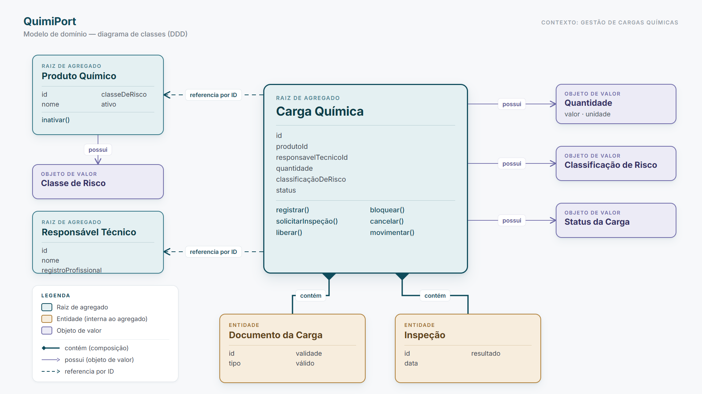
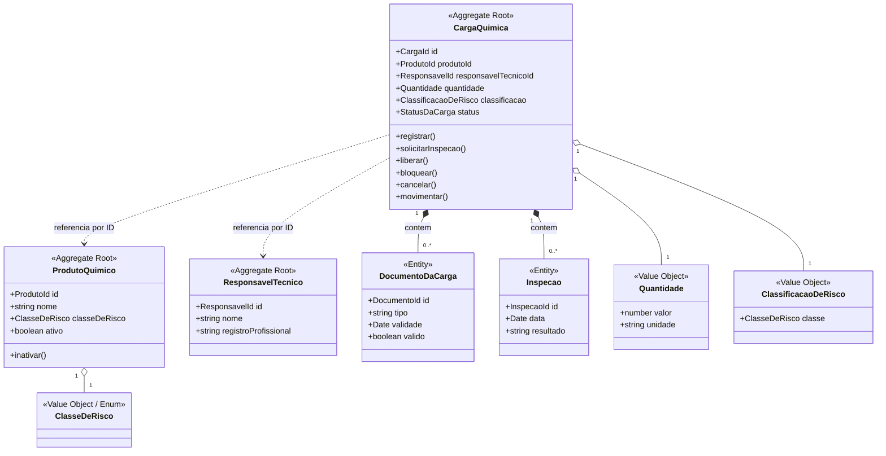
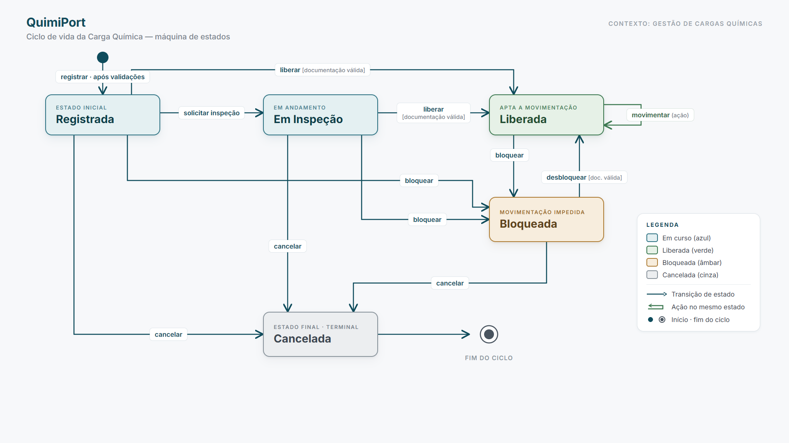
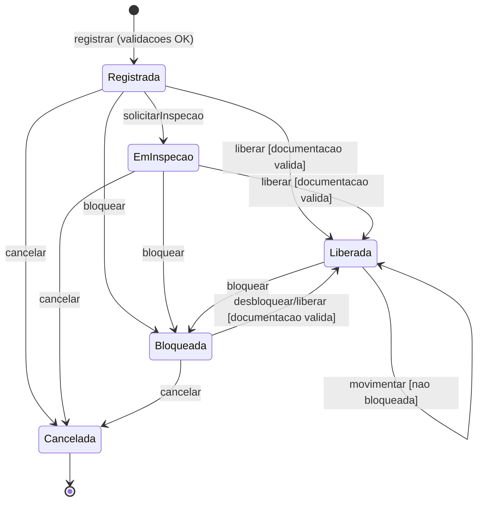
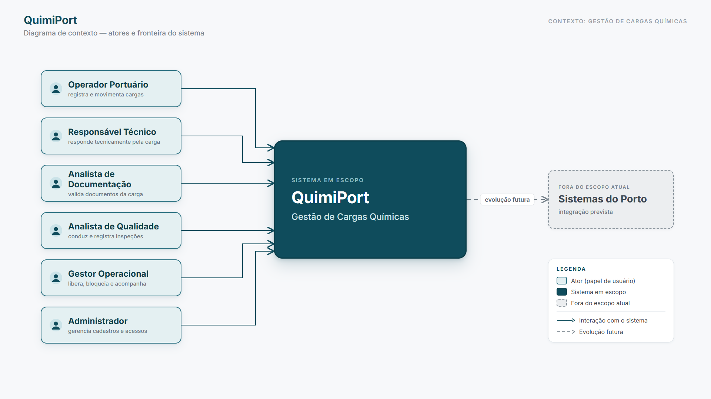
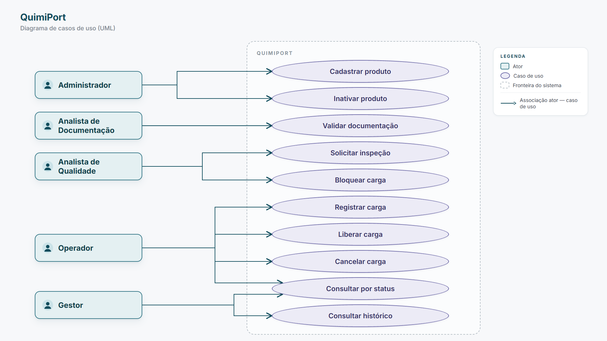
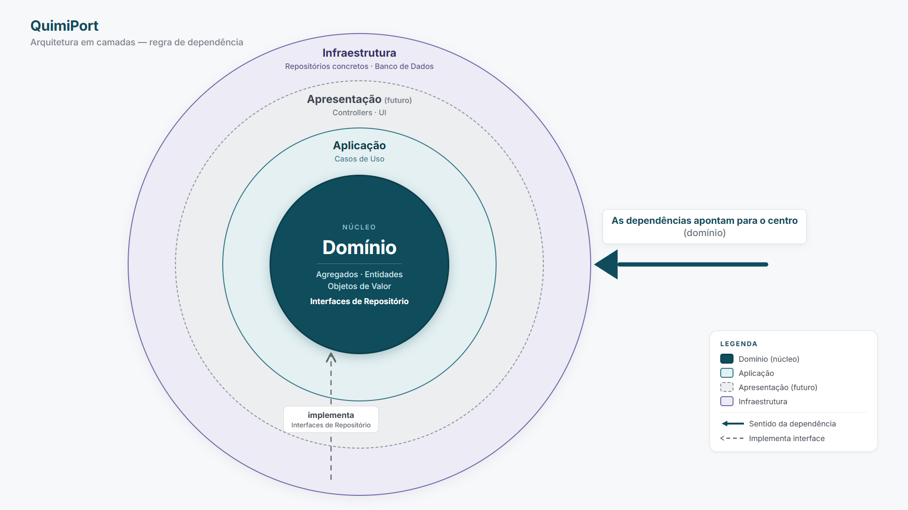

# 07 · Diagramas

> Os **obrigatórios** para a entrega são o **Diagrama de Domínio** e o **Fluxo de Status da Carga**; os demais são apoio. As imagens abaixo são as versões finais; o código-fonte em **Mermaid** de cada uma fica logo abaixo, recolhível.

---

## Diagrama de Domínio
> **Obrigatório.** Agregados, entidades, objetos de valor e relacionamentos.

Legenda: losango cheio = composição (a parte pertence ao agregado); linha simples = objeto de valor; linha tracejada = referência por ID entre agregados.

Código-fonte (Mermaid)

---

## Fluxo de Status da Carga Química
> **Obrigatório.** Máquina de estados. "Movimentar" é uma **ação** sobre a carga Liberada, não um estado.

Código-fonte (Mermaid)

---

## Diagrama de Contexto
> Apoio. Quem interage com o QuimiPort.

---

## Diagrama de Casos de Uso
> Apoio. Atores e casos de uso.

---

## Arquitetura em Camadas
> Apoio. A regra de dependência aponta sempre para o domínio (núcleo).

