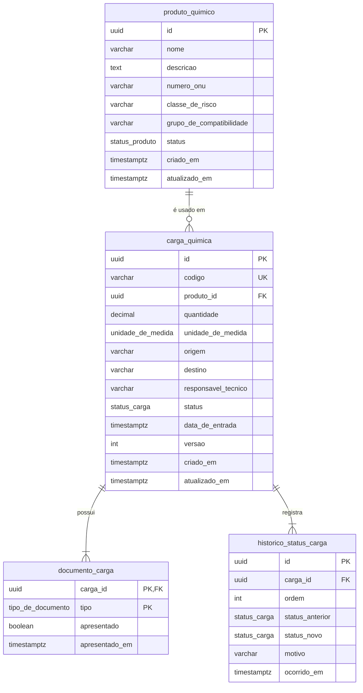

# 11 · Banco de Dados e Modelagem

> Fase 2. Como o domínio modelado na Fase 1 foi persistido: escolha do banco, tabelas, chaves, relacionamentos, controle de status e evolução futura.

## Por que PostgreSQL

- **Os dados são relacionais por natureza.** Toda carga referencia um produto; documentos e histórico pertencem a uma carga. Com chaves estrangeiras, a integridade é garantida pelo próprio banco, não só pela aplicação.
- **Transações ACID.** Uma mudança de status grava a carga e o registro de histórico juntos: ou tudo é salvo, ou nada é.
- **Tipos adequados ao domínio.** `ENUM` nativo para status e unidades, `DECIMAL` exato para quantidades (sem erro de arredondamento de ponto flutuante) e `TIMESTAMPTZ` para datas com fuso horário.
- **Maduro, gratuito e com imagem oficial no Docker** (`postgres:17-alpine`).

O acesso é feito com o **Prisma 6** (ORM + migrations versionadas em `prisma/migrations`). O Prisma fica isolado na infraestrutura, atrás das interfaces de repositório declaradas no domínio ([ADR-006](10-decisoes-arquiteturais.md)): trocar de banco ou de ORM não afeta as regras de negócio.

## Diagrama entidade-relacionamento

## Tabelas

### `produto_quimico`

| Coluna | Tipo | Regra |
|---|---|---|
| `id` | `uuid` | **PK**. Gerado pela aplicação |
| `nome` | `varchar(150)` | Obrigatório |
| `descricao` | `text` | Opcional |
| `numero_onu` | `varchar(6)` | Opcional, normalizado para o formato `UN0000` |
| `classe_de_risco` | `varchar(3)` | Obrigatória. Classe ONU (ex.: `3`, `6.1`, `8`) |
| `grupo_de_compatibilidade` | `varchar(30)` | Opcional |
| `status` | `status_produto` | `ATIVO` ou `INATIVO` (padrão `ATIVO`) |
| `criado_em` / `atualizado_em` | `timestamptz` | Auditoria |

### `carga_quimica`

| Coluna | Tipo | Regra |
|---|---|---|
| `id` | `uuid` | **PK** |
| `codigo` | `varchar(40)` | **Único**. Identificador de negócio da carga (ex.: `CQ-2026-0001`) |
| `produto_id` | `uuid` | **FK** → `produto_quimico.id` |
| `quantidade` | `decimal(14,3)` | Maior que zero (validado no domínio) |
| `unidade_de_medida` | `unidade_de_medida` | `KG`, `T`, `L` ou `M3` |
| `origem` / `destino` | `varchar(150)` | Obrigatórios |
| `responsavel_tecnico` | `varchar(150)` | Obrigatório |
| `status` | `status_carga` | Status atual (ver [fluxo de status](12-fluxo-de-status.md)) |
| `data_de_entrada` | `timestamptz` | Entrada da carga no porto |
| `versao` | `int` | Controle de concorrência otimista (ver abaixo) |
| `criado_em` / `atualizado_em` | `timestamptz` | Auditoria |

### `documento_carga`

Cada carga tem **exatamente uma linha por documento obrigatório** (FDS, Ficha de Emergência e Declaração de Mercadoria Perigosa), criadas junto com a carga. Assim, a pendência de documentação é uma consulta simples, e não a ausência de uma linha.

| Coluna | Tipo | Regra |
|---|---|---|
| `carga_id` | `uuid` | **PK** composta + **FK** → `carga_quimica.id` |
| `tipo` | `tipo_de_documento` | **PK** composta. Impede documento duplicado na mesma carga |
| `apresentado` | `boolean` | Se o documento foi apresentado |
| `apresentado_em` | `timestamptz` | Quando foi apresentado |

### `historico_status_carga`

Trilha de auditoria: **toda mudança de status gera uma linha**, inclusive o registro inicial.

| Coluna | Tipo | Regra |
|---|---|---|
| `id` | `uuid` | **PK** |
| `carga_id` | `uuid` | **FK** → `carga_quimica.id` |
| `ordem` | `int` | Sequência das transições. **Único** junto com `carga_id` |
| `status_anterior` | `status_carga` | Nulo no registro inicial |
| `status_novo` | `status_carga` | Status após a transição |
| `motivo` | `varchar(500)` | Obrigatório para bloqueio e cancelamento |
| `ocorrido_em` | `timestamptz` | Momento da transição |

## Relacionamentos

| Relação | Cardinalidade | Observação |
|---|---|---|
| Produto → Cargas | 1 : N | Um produto pode estar em várias cargas; a carga referencia o produto **por ID** (agregados distintos) |
| Carga → Documentos | 1 : 3 | Composição: os documentos fazem parte do agregado Carga |
| Carga → Histórico | 1 : N | Composição: o histórico faz parte do agregado Carga e só cresce |

O **agregado Carga** é gravado em três tabelas (`carga_quimica`, `documento_carga`, `historico_status_carga`) **dentro de uma única transação**, para que nunca fique pela metade no banco.

## Índices

| Índice | Motivo |
|---|---|
| `carga_quimica.codigo` (único) | Impede códigos repetidos e acelera a busca por código |
| `carga_quimica.status` | Filtro `GET /cargas-quimicas?status=` |
| `carga_quimica.produto_id` | Filtro por produto e verificação da FK |
| `produto_quimico.status` | Filtro `GET /produtos-quimicos?status=` |
| `historico_status_carga (carga_id, ordem)` (único) | Ordem das transições sem repetição |

## Controle de status

- As **transições** são validadas no domínio (máquina de estados em `CargaQuimica.alterarStatus()`).
- O **banco é a última barreira**: os status são `ENUM` nativos, então um valor fora da lista é recusado mesmo que a aplicação falhe.
- O **histórico** guarda de onde, para onde, quando e por quê, permitindo reconstruir toda a vida de uma carga.

## Sem exclusão física

Nenhum registro é apagado com `DELETE`:

- **Produto:** é **inativado** (`status = INATIVO`) e deixa de poder ser usado em novas cargas.
- **Carga:** é **cancelada** (`status = CANCELADA`, com motivo) e passa a ser um estado final.
- As chaves estrangeiras usam `ON DELETE RESTRICT`: o próprio banco recusa apagar um produto que já foi usado em cargas, ou uma carga que tem documentos e histórico. Os repositórios não têm método de exclusão.

## Concorrência otimista

A coluna `versao` evita que duas operações simultâneas sobrescrevam uma à outra (ex.: dois operadores alterando o status da mesma carga ao mesmo tempo):

1. A carga é lida com sua versão (ex.: `versao = 3`).
2. A atualização só é aplicada `WHERE id = ? AND versao = 3`, incrementando a versão para 4.
3. Se outra operação gravou antes, nenhuma linha é atualizada e a API responde **409 Conflito**, pedindo para tentar novamente.

Depois de criada, a carga só tem **status e documentação** alterados. Os demais campos (produto, quantidade, origem, destino) são imutáveis, como num registro de entrada.

## Evolução futura

- **Responsável técnico como tabela própria**, com registro profissional (CRQ) validado. Hoje é um campo de texto.
- **Arquivos dos documentos** (PDF da FDS etc.) em armazenamento de objetos, com URL e validade na tabela `documento_carga`.
- **Inspeções** como tabela própria (data, inspetor, resultado), prevista na Fase 1 e adiada.
- **Autoria das ações** (`alterado_por` no histórico) quando houver autenticação.
- **Paginação** nas listagens e índice composto `(status, data_de_entrada)` conforme o volume crescer.
