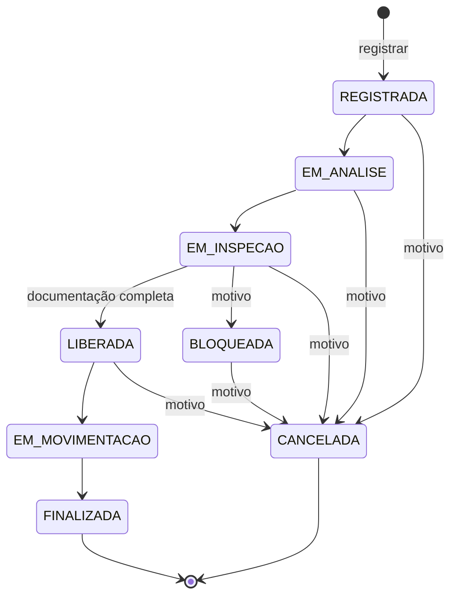

# 12 · Fluxo de Status da Carga

> Fase 2. A máquina de estados implementada em `src/domain/carga/StatusDaCarga.ts` e `CargaQuimica.alterarStatus()`.

## Status

| Status | Significado |
|---|---|
| `REGISTRADA` | Carga cadastrada no sistema; status inicial |
| `EM_ANALISE` | Documentação e dados em análise |
| `EM_INSPECAO` | Carga em inspeção física |
| `LIBERADA` | Aprovada para movimentação (exige documentação completa) |
| `BLOQUEADA` | Retida por problema identificado (exige motivo) |
| `EM_MOVIMENTACAO` | Sendo movimentada no porto |
| `FINALIZADA` | Movimentação concluída — **status final** |
| `CANCELADA` | Cancelada (exige motivo) — **status final** |

## Diagrama

## Transições permitidas

Qualquer transição **fora desta tabela é recusada** (lista de permissões: o que não está explicitamente permitido é proibido).

| De | Para |
|---|---|
| `REGISTRADA` | `EM_ANALISE`, `CANCELADA` |
| `EM_ANALISE` | `EM_INSPECAO`, `CANCELADA` |
| `EM_INSPECAO` | `LIBERADA`, `BLOQUEADA`, `CANCELADA` |
| `LIBERADA` | `EM_MOVIMENTACAO`, `CANCELADA` |
| `BLOQUEADA` | `CANCELADA` |
| `EM_MOVIMENTACAO` | `FINALIZADA` |
| `FINALIZADA` | — |
| `CANCELADA` | — |

## Regras aplicadas em cada mudança

Toda mudança de status passa por **um único método**, `CargaQuimica.alterarStatus()`. Os endpoints `/status`, `/liberar`, `/bloquear` e `/cancelar` chegam todos a ele, então a regra existe em um lugar só. As verificações acontecem nesta ordem:

| # | Verificação | Se falhar | HTTP |
|---|---|---|---|
| 1 | A carga não está em status final (`FINALIZADA`/`CANCELADA`) | `TRANSICAO_DE_STATUS_INVALIDA` | 409 |
| 2 | A transição está na tabela de permitidas | `TRANSICAO_DE_STATUS_INVALIDA` (a mensagem lista as permitidas) | 409 |
| 3 | Para `LIBERADA`: os 3 documentos obrigatórios foram apresentados | `REGRA_DE_NEGOCIO` (a mensagem lista os pendentes) | 422 |
| 4 | Para `BLOQUEADA` e `CANCELADA`: motivo informado | `VALIDACAO` | 400 |

Se tudo passar, o status muda e uma linha é acrescentada ao **histórico** (status anterior, novo, motivo e data).

**409 × 422:** o 409 indica que a operação **não faz sentido no estado atual** (pular etapas, mexer em carga finalizada). O 422 indica que a transição é válida, mas **uma regra de negócio impede** (falta documentação).

### Documentação obrigatória

- FDS (Ficha de Dados de Segurança), Ficha de Emergência e Declaração de Mercadoria Perigosa.
- Pode ser informada no registro da carga e complementada depois (`PATCH /cargas-quimicas/:id/documentos`) enquanto a carga está `REGISTRADA`, `EM_ANALISE` ou `EM_INSPECAO`. Depois disso, a documentação fica congelada.

## Endpoints

| Endpoint | Efeito |
|---|---|
| `PATCH /cargas-quimicas/:id/status` | Qualquer transição permitida (`{ "status": "...", "motivo": "..." }`) |
| `PATCH /cargas-quimicas/:id/liberar` | Atalho para `LIBERADA` |
| `PATCH /cargas-quimicas/:id/bloquear` | Atalho para `BLOQUEADA` (motivo obrigatório) |
| `PATCH /cargas-quimicas/:id/cancelar` | Atalho para `CANCELADA` (motivo obrigatório) |

## Regras de negócio cobertas

| Regra (Fase 1) | Como é garantida |
|---|---|
| RN-04 · Não liberar sem documentação | Verificação 3 |
| RN-05 · Carga bloqueada não entra em movimentação | `BLOQUEADA` só pode ir para `CANCELADA` |
| RN-06 · Carga cancelada não pode ser liberada | `CANCELADA` é status final |
| RN-07 · Carga em inspeção não é finalizada sem ser liberada | `FINALIZADA` só é alcançável a partir de `EM_MOVIMENTACAO`, que exige `LIBERADA` |

## O que mudou em relação à Fase 1

O [fluxo da Fase 1](07-diagramas.md) foi uma proposta inicial. Na Fase 2 o enunciado definiu os status oficiais, e o fluxo foi refeito sobre eles:

| Fase 1 | Fase 2 | Motivo |
|---|---|---|
| "Movimentar" era uma ação sobre a carga liberada | `EM_MOVIMENTACAO` e `FINALIZADA` são status | Permite saber quais cargas estão sendo movimentadas e quais já concluíram |
| `REGISTRADA` podia ir direto para `LIBERADA` | Passa obrigatoriamente por `EM_ANALISE` e `EM_INSPECAO` | Nenhuma carga perigosa é liberada sem análise e inspeção |
| `BLOQUEADA` podia voltar para `LIBERADA` | `BLOQUEADA` só pode ser cancelada | Uma carga com problema não volta ao fluxo silenciosamente; a correção exige um novo registro, com nova análise |
| Motivo não era exigido | Bloqueio e cancelamento exigem motivo | Rastreabilidade: o histórico registra por que a carga saiu do fluxo |
